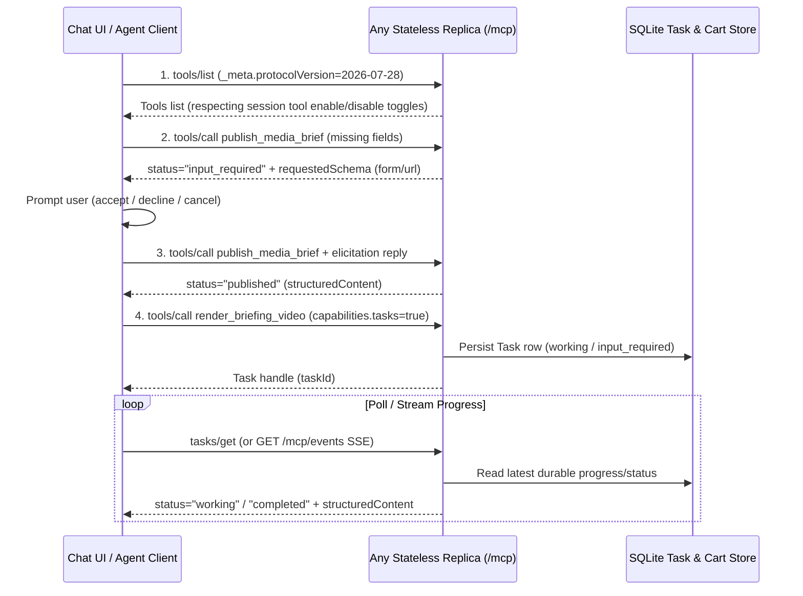

# Architecture & Protocol Sequence (`mcp-studio-tasks`)

## Stateless Runtime + Durable Tasks + Elicitation Flow

## Module Responsibilities

- [`state.py`](../src/mcp_studio_tasks/state.py): Durable server-side `cart_id` handles enforcing caller `owner_sub` verification alongside HMAC-SHA256 signed client-carried cursor handles.
- [`elicitation.py`](../src/mcp_studio_tasks/elicitation.py): Multi-round-trip `input_required` form and URL elicitation flows, blocking credential/payment collection in form fields (`INV-ADV-04`) and falling back cleanly when clients omit elicitation capabilities.
- [`tasks.py`](../src/mcp_studio_tasks/tasks.py): Restart-resilient SQLite `TaskManager` implementing `tasks/get`, `tasks/update`, `tasks/cancel`, and SSE `notifications/progress` / `list_changed` events.
- [`content.py`](../src/mcp_studio_tasks/content.py): Context-aware `completion/complete`, stdlib PNG/WAV multimodal generators, `resource_link` vs. embedded resources, and token-cost savings estimation.
- [`agent_client.py`](../src/mcp_studio_tasks/agent_client.py): End-to-end async chat client automating tool selection, elicitation retries, and background task polling.
